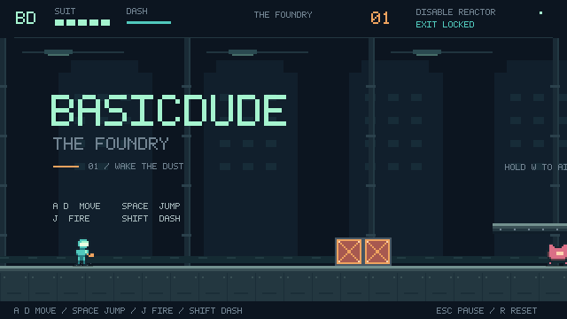
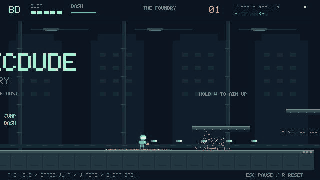

# BASICDUDE — The Foundry

A small **native desktop** action platformer made with Godot 4.6.1. Run, jump, dash, and fire an arm cannon through a quiet industrial ruin. Hits chip actual colored pixels out of enemies and crates; the removed pixels fall, bounce, and settle. Disable the reactor and reach the exit.



## Play

**Desktop downloads:** open this repository's [Actions page](https://github.com/esotericode/basicdude/actions), select a successful **Test and build desktop game** run for this branch, and download the **basicdude-desktop** artifact. Extract it, then extract the archive for your operating system:

- **Windows (x64):** open `basicdude-windows.exe`.
- **Linux (x64):** extract the `.tar.gz` and run `./basicdude-linux.x86_64`. The archive preserves executable permissions.
- **macOS (Intel / Apple Silicon):** extract the ZIP and open the `.app`. This prototype has an ad-hoc signature and is not notarized; macOS may require **Privacy & Security → Open Anyway** for a downloaded build. See [Godot's macOS running instructions](https://docs.godotengine.org/en/4.6/tutorials/export/running_on_macos.html).

**From source:** install the standard (non-.NET) [Godot 4.6.1](https://github.com/godotengine/godot/releases/tag/4.6.1-stable), import `project.godot`, and press **F5**. Nothing else to install. From a terminal:

```sh
godot --path .
```

| Action | Keyboard | Gamepad |
| --- | --- | --- |
| Move | A / D or left / right arrows | Left stick / D-pad |
| Jump (hold for height) | Space or Z | A / bottom face button |
| Fire (hold to repeat) | J or X | X / left face button or right shoulder |
| Dash | Shift, K, or C | B / right face button or left shoulder |
| Aim up / diagonal | W or up arrow; move for diagonal | Stick / D-pad up |
| Aim down while airborne | S or down arrow | Stick / D-pad down |
| Pause / resume | Esc or P | Start |
| Restart the whole level | R | Back / Select |
| Fullscreen | F11 | — |
| Mute effects | M | — |

The checkpoint restores health and becomes your respawn location. Falling into a gap reboots the suit there (or at the start before activation). Enemies and objects reset on respawn. The reactor takes repeated shots; its destruction opens the pink gate. Dashing briefly protects against enemies. The game pauses when its window loses focus; press Esc to resume.

## What this prototype focuses on

- **Movement:** quick acceleration and braking, direct air control, variable jump height, a 100 ms coyote window, and a 110 ms jump buffer. The physics loop runs at 120 Hz with input accumulation disabled. The camera eases; the player does not wait for it.
- **Shooting:** first shot on the next physics step, held fire every 105 ms, horizontal / vertical / diagonal aiming, visible muzzle flashes, and swept collision to catch thin targets at high projectile speed.
- **Damage:** a short flash and stagger, with colored cells removed from the visible model on every hit. Collision against the remaining sprite pixels follows the holes. Enough hits shatter the rest of the model. Crates keep their solid movement collider until destroyed.
- **Debris:** gravity, swept landing on terrain and platforms, damped bounces, friction, then sleep. At most 900 fragments are kept; resting fragments stop simulating and fade after 10–15 seconds. They are cosmetic and do not obstruct movement.
- **Presentation:** a 640×360 pixel grid, integer scaling, a restrained palette, original pixel sprites and bitmap text, subtle impact shake, and small synthesized sound effects. No browser, external assets, or asset downloads at runtime.



This is one short playable level, built to test the movement and destruction idea. It is not yet a Metroidvania: no save file, inventory, upgrade tree, or world map. The next design decisions should come from playing it on a real keyboard or controller.

## Verify and export

```sh
godot --headless --path . --editor --import --quit
godot --headless --path . --audio-driver Dummy --fixed-fps 120 --script tests/gameplay.gd
godot --headless --path . --audio-driver Dummy --fixed-fps 120 --script tests/walkthrough.gd
```

The integration suite checks 28 behaviors, including movement response, jump buffering, edge jumps, damage invulnerability, real projectile damage, full object destruction, debris settling, checkpoint respawn, pause, and completion. The walkthrough clears the entire level using ordinary movement, jump, and fire input, without teleporting or changing health.

Install the matching **4.6.1 export templates** through **Editor → Manage Export Templates**, then use **Project → Export** or:

```sh
mkdir -p builds
godot --headless --path . --export-release Linux
godot --headless --path . --export-release Windows
godot --headless --path . --export-release macOS
```

The GitHub Actions workflow verifies pinned engine/template SHA-256 digests, runs both gameplay checks, exports all three platforms, smoke-tests the Linux executable, and attaches the archives. Windows and macOS are cross-built; they still need testing on their target systems. Controller mappings are included; physical controller hardware was not available for validation.

Rendering checks can be repeated with `godot --path . --audio-driver Dummy --fixed-fps 120 --script tests/capture.gd` using a desktop display, or with `xvfb-run` on Linux. See [docs/DEVELOPMENT.md](docs/DEVELOPMENT.md) for the code layout and tuning points, and [THIRD_PARTY_NOTICES.txt](THIRD_PARTY_NOTICES.txt) for the engine notice.
